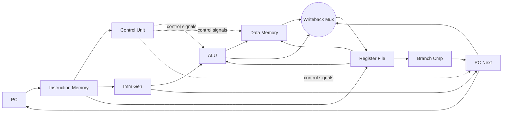

<h1 align="center">RISC-V RV32I Processor</h1>

<p align="center">
  A 32-bit RISC-V (RV32I) processor in SystemVerilog, built module by module,<br>
  with a self-checking testbench for every block.
</p>

<p align="center">
  
  
  
  
  
</p>

---

## 📌 Overview

This project implements a RISC-V RV32I processor from scratch. Every datapath
block is written in SystemVerilog and verified on its own with a self-checking
testbench that prints `PASS` or `FAIL`. The verified blocks are then integrated
into a single-cycle core, which will later be extended to a 5-stage pipeline.

**Goals**

- 🧱 Build the core bottom-up: test each module alone, then integrate
- ✅ Self-checking testbenches with edge cases (signed/unsigned, sign extension, x0 protection)
- 🚀 Extend to a 5-stage pipeline with forwarding and hazard handling
- 🔍 Add verification: Spike comparison, assertions and functional coverage

---

## 🧩 Modules

| Module | Description | Testbench |
|---|---|:---:|
| `pc` | Program counter with synchronous reset | ✅ |
| `branch_cmp` | beq, bne, blt, bge, bltu, bgeu (signed and unsigned) | ✅ |
| `pc_next` | Next-PC select: PC+4, branch/JAL target, JALR target | ✅ |
| `instr_mem` | Instruction memory loaded from `program.hex` | ✅ |
| `regfile` | 32 x 32-bit registers, 2 read ports, 1 write port, x0 = 0 | ✅ |
| `alu` | add, sub, and, or, xor, shifts, slt, sltu, pass-B | ✅ |
| `imm_gen` | I, S, B, U and J immediate decoding with sign extension | ✅ |
| `control_unit` | Opcode decode and all control signals | ✅ |
| `data_mem` | Byte, halfword and word load/store (little-endian) | ✅ |
| `cpu_top` | Single-cycle top-level integration | 🔜 |

---

## 🏗️ Datapath



---

## 📁 Repository Structure

```
.
├── rtl/      Design files (SystemVerilog)
├── tb/       Self-checking testbenches
└── tests/    Test programs (program.hex)
```

---

## ▶️ How to Simulate

1. Create a Vivado project and add the files in `rtl/` as **design sources**.
2. Add the files in `tb/` and `tests/program.hex` as **simulation sources**.
3. Set the file type of each source to **SystemVerilog**.
4. Right-click the testbench you want, choose **Set as Top**, then run **Behavioral Simulation**.
5. Read the result in the **Tcl Console**. Every check prints `PASS` or `FAIL`.

> **Note:** `instr_mem` loads `program.hex` with `$readmemh`. If instructions show
> as NOPs, check the file path in the testbench.

---

## 🗺️ Roadmap

- [x] PC, branch comparator, PC-next logic, instruction memory
- [x] Register file, ALU, immediate generator, control unit, data memory
- [ ] `cpu_top`: single-cycle integration and test programs
- [ ] RISC-V GCC toolchain flow and `riscv-arch-test` compliance
- [ ] Lockstep comparison against Spike
- [ ] 5-stage pipeline: forwarding, load-use stall, branch flush
- [ ] SystemVerilog assertions and functional coverage
- [ ] Optional: FPGA demo

---

## 🛠️ Tools

| Purpose | Tool |
|---|---|
| RTL and testbenches | SystemVerilog |
| Simulation | Xilinx Vivado 2023.2 (xsim) |
| Version control | Git and GitHub |

---

## 👤 Author

**G.deekshitha**, 3rd-year ECE student, aiming for a career in design verification/embedded systems.

<p align="center">
  
</p>
